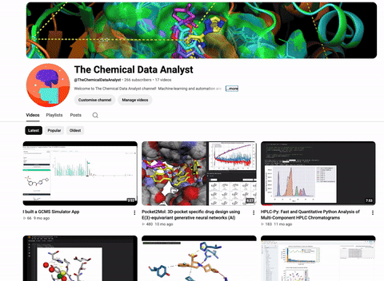

# 🧪 Cheminformatics Colab Notebooks

**Ready-to-run Google Colab notebooks for drug discovery, chemical library generation, reaction optimisation, and analytical chemistry.**

🖥️ **13 notebooks** &nbsp;·&nbsp; 🎥 **Video tutorial for every tool** &nbsp;·&nbsp; ⚡ **GPU-accelerated where it counts** &nbsp;·&nbsp; 🔬 **Covers drug discovery, libraries, reactions & analytics**

---

## 📑 Contents

- [Notebook index](#-notebook-index)
  - [🧬 Drug discovery & structure-based design](#-drug-discovery--structure-based-design)
  - [📚 Chemical libraries & chemical space](#-chemical-libraries--chemical-space)
  - [⚗️ Reactions & synthesis](#️-reactions--synthesis)
  - [📊 Analytical chemistry & molecular properties](#-analytical-chemistry--molecular-properties)
- [How to use](#-how-to-use)
- [Other files](#-other-files)
- [Credits](#-credits)

> **Legend:** ⚡ GPU runtime · ✅ CPU runtime · 🎥 video tutorial · 🐛 tracked issue · — not applicable/none yet

---

## 📓 Notebook index

Click the Colab badge to open a notebook directly. `.zip` entries link to the file; download, unzip, then upload the notebook to [Colab](https://colab.research.google.com) (File > Upload notebook).

### 🧬 Drug discovery & structure-based design

| Notebook | Tool | What it does | Main input | Runtime | Colab Notebook | Tutorial | Relevant Issues |
|---|---|---|---|---|---|---|---|
| `Boltz_2 (1).ipynb` | Boltz-2 | Predicts biomolecular complex structures and binding affinity. Walks through fetching a PDB, identifying the ligand, then running Boltz-2 and viewing results in 3D. | PDB / ligand | ⚡ GPU |  | [🎥 Video](https://www.youtube.com/watch?v=qoTCODBySTw&t=556s) | — |
| `Pocket2Mol (3).ipynb` | Pocket2Mol | De novo generation of 3D drug-like molecules inside a protein pocket using an E(3)-equivariant generative network. | Protein pocket | ⚡ GPU |  | [🎥 Video](https://www.youtube.com/watch?v=S1P4_qgQay4) | — |
| `pharmacoforge.ipynb` | PharmacoForge | Pharmacophore generation with a diffusion model for a receptor pocket, defined by a reference ligand or a residue list. | Receptor PDB | ⚡ GPU |  | — | — |
| `PocketVina_(P2Rank_and_QuickVina_2_GPU_2_1) (10).ipynb` | PocketVina | Two-stage multi-pocket docking: P2Rank predicts ligandable pockets, then QuickVina 2-GPU docks at each. | Protein + ligands | ⚡ GPU |  | [🎥 Video](https://www.youtube.com/watch?v=_ZWizDyrgN0) | — |

### 📚 Chemical libraries & chemical space

| Notebook | Tool | What it does | Main input | Runtime | Colab Notebook | Tutorial | Relevant Issues |
|---|---|---|---|---|---|---|---|
| `Core_decoration_using_combinatorial_chemistry_+_ZINC22_database.ipynb` | ZINC22 core decoration | Downloads ZINC22 tranches and decorates a core scaffold combinatorially with purchasable building blocks. | Core SMILES, ZINC22 tranche | ✅ CPU |  | [🎥 Video](https://www.youtube.com/watch?v=WI5317srMno) | — |
| `millions_library_colab_standard.ipynb` | Millions-scale library enumeration | Bins building blocks by reaction type and enumerates a library around a core scaffold, sized for free-tier Colab. Also available as `millions_library_colab_standard.py`. | Core SMILES, building blocks | ✅ CPU |  | — | — |
| `Billions_Library_GCE_V2.ipynb` | Billions-scale library enumeration | C++-accelerated, billions-scale fragment-growing combinatorial library build on Google Compute Engine; a much faster iteration of the Python-based millions-scale notebook. | Core SMILES, building blocks | ✅ CPU |  | — | [🐛 #3](https://github.com/tommbk50-hub/Cheminformatics/issues/3) |
| `BitBIRCH_Lean (1).ipynb` | BitBIRCH-Lean | Fast, memory-efficient clustering of very large molecular libraries using bit-packed fingerprints. | SMILES library | ✅ CPU |  | [🎥 Video](https://www.youtube.com/watch?v=1YKMBSrb6N0) | — |

### ⚗️ Reactions & synthesis

| Notebook | Tool | What it does | Main input | Runtime | Colab Notebook | Tutorial | Relevant Issues |
|---|---|---|---|---|---|---|---|
| `bayesian_reaction_optimisation (2).ipynb` | Bayesian reaction optimisation | Uses Bayesian optimisation to find high-yield reaction conditions in fewer experiments. | Reaction condition data | ✅ CPU |  | [🎥 Video](https://www.youtube.com/watch?v=i80bhwqF25w&t=190s) | — |
| `SynPlanner.zip` | SynPlanner | Retrosynthesis planning with Monte-Carlo tree search and GNNs. Unzip to get `SynPlanner.ipynb`. | Target SMILES | ⚡ GPU | [📦 File](https://github.com/tommbk50-hub/Cheminformatics/blob/main/SynPlanner.zip) | [🎥 Video](https://www.youtube.com/watch?v=NCcku4KovAc&t=31s) | — |

### 📊 Analytical chemistry & molecular properties

| Notebook | Tool | What it does | Main input | Runtime | Colab Notebook | Tutorial | Relevant Issues |
|---|---|---|---|---|---|---|---|
| `HPLC-Py.ipynb` | HPLC-Py | Peak detection and quantification of HPLC chromatograms. | Chromatogram data | ✅ CPU |  | [🎥 Video](https://www.youtube.com/watch?v=K8d2b8Ljny4&t=13s) | — |
| `GCMS_simulator__colab (5).zip` | GC-MS simulator | Predicts a fragmentation tree and simulated GC-MS spectrum from a SMILES. Unzip to get the notebook. | SMILES | ✅ CPU | [📦 File](https://github.com/tommbk50-hub/Cheminformatics/blob/main/GCMS_simulator__colab%20%285%29.zip) | [🎥 Video](https://www.youtube.com/watch?v=rbkOwAOXoY8) | — |
| `UVVis-ML.zip` | UV-Vis ML | Predicts molecular optical (UV-Vis) peaks with deep learning (Chem. Sci. 2022). Unzip to get `uvvisml (1).ipynb`. | SMILES | ✅ CPU | [📦 File](https://github.com/tommbk50-hub/Cheminformatics/blob/main/UVVis-ML.zip) | [🎥 Video](https://www.youtube.com/watch?v=-kaYCyI7woc) | — |
| `Uni_pKa.ipynb` | Uni-pKa | pKa prediction. **Note: the file in the repo is currently empty.** | SMILES | — | [📦 File](https://github.com/tommbk50-hub/Cheminformatics/blob/main/Uni_pKa.ipynb) | [🎥 Video](https://www.youtube.com/watch?v=WcG1GpVonc8) | — |
| `UnoMD.zip` | UnoMD | Simplified OpenMM molecular dynamics setup. Unzip to get `UnoMD.ipynb`. | PDB / ligand | ⚡ GPU | [📦 File](https://github.com/tommbk50-hub/Cheminformatics/blob/main/UnoMD.zip) | [🎥 Video](https://www.youtube.com/watch?v=hlrdBJsCWS8) | — |

---

## 🚀 How to use

1. Click **Open in Colab** (or upload the notebook to [colab.research.google.com](https://colab.research.google.com)).
2. For ⚡ GPU notebooks, choose **Runtime > Change runtime type > GPU** (a T4 is enough for most).
3. Run cells top to bottom. The first cells install dependencies; some (e.g. condacolab) restart the runtime once.
4. Upload your inputs when prompted. Files in `/content` are lost when the session ends, so download your results.

> ℹ️ PharmacoForge needs runtime version 2025.07 (see the notebook header).

---

## 📂 Other files

- `millions_library_colab_standard.py`: script export of the millions-scale notebook.
- `billions_library_gce_v2 (2).py`: script export of `Billions_Library_GCE_V2.ipynb`, the billions-scale version for a large Google Compute Engine VM (uses RAM disk and more memory); not for free Colab.

---

## 🙏 Credits

Each notebook wraps an upstream tool or paper, which is linked inside the notebook. Please cite the original authors when you use these tools.

---

⭐ **If you find these notebooks useful, consider starring the repo!** ⭐

📺 [YouTube: TheChemicalDataAnalyst](https://www.youtube.com/@TheChemicalDataAnalyst) &nbsp;·&nbsp; 🐛 [Report an issue](https://github.com/tommbk50-hub/Cheminformatics/issues) &nbsp;·&nbsp; 🤝 [Contribute](https://github.com/tommbk50-hub/Cheminformatics/pulls)

